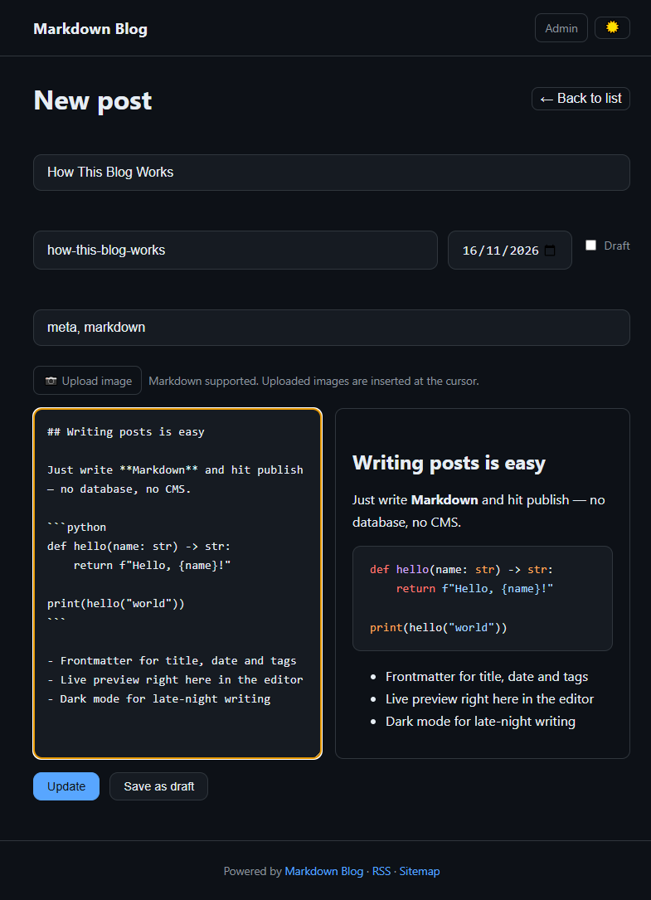

# Markdown Blog

### Your blog is just a folder of Markdown files.

A fast, minimalist, self-hosted blog engine with **zero database**. Write `.md` files (or use the built-in browser editor), drop them in a folder, and Docker serves a beautiful blog with dark mode, search, tags, SEO and RSS.

No MySQL. No Postgres. No CMS to babysit. The filesystem *is* the database — and your content stays portable forever.

[](LICENSE)
[](https://github.com/muhammadalikachi/markdown-blog/actions/workflows/docker.yml)
[](https://nextjs.org)
[](#-quick-start-docker)
[](https://github.com/muhammadalikachi/markdown-blog/stargazers)

<!-- TODO: replace the template id once the app is registered with Hostinger -->
[](https://deploy.pages.hostinger.dev/template/markdown-blog)


## Why another blog engine?

Most self-hosted blogs are WordPress, Ghost, or a static site generator. They're great — until you want something in between:

| | WordPress / Ghost | Static generators | **Markdown Blog** |
|---|---|---|---|
| Database required | ✅ MySQL / SQLite | ❌ | **❌ none** |
| Write from the browser | ✅ | ❌ | **✅ built-in admin** |
| Content is portable files | ❌ | ✅ | **✅ plain `.md`** |
| One-command Docker deploy | ~ | ~ | **✅** |
| No build step per post | ❌ | ❌ | **✅ files read at runtime** |

If you want **a real editor in the browser** *and* **your posts as plain files you own** — without running a database — this is for you.

## ✨ Features

**Writing**
- 🔐 Password-protected admin at `/admin` (credentials from env vars)
- ✍️ Create, edit, delete posts from the browser
- 👁️ **Live preview** — rendered Markdown side-by-side as you type
- 🖼️ Image uploads — URL inserted at your cursor automatically
- 📝 Draft mode for unfinished posts

**Reading**
- 🎨 Clean, minimalist, mobile-first UI
- 🌙 **Dark / light mode** — system-aware and remembered
- 🔎 **Instant search** and 🏷️ tag filtering
- 💻 Syntax highlighting for dozens of languages

**Shipping**
- 🔎 SEO-ready: per-post meta + OpenGraph/Twitter cards, JSON-LD
- 📡 Auto-generated `sitemap.xml`, `rss.xml`, `robots.txt`
- 🐳 Multi-stage Docker image with **persistent volumes**
- ⚡ Fast: ~97 kB First Load JS, no database round-trips

## 🚀 Quick start (Docker)

**Prerequisite:** Docker + Docker Compose.

```bash
git clone https://github.com/muhammadalikachi/markdown-blog.git
cd markdown-blog

cp .env.example .env
# Edit .env: set ADMIN_PASSWORD, AUTH_SECRET and SITE_URL
# Generate a secret:  openssl rand -hex 32

docker compose up -d --build
```

That's it:

| | |
|---|---|
| 📖 Blog | http://localhost:3000 |
| 🔐 Admin | http://localhost:3000/admin |

Your posts live in the `posts/` volume and uploads in `uploads/` — they survive every rebuild and update.

### Or pull the prebuilt image

```bash
docker pull ghcr.io/muhammadalikachi/markdown-blog:latest
```

## 💻 Quick start (local development)

Requires Node.js 18.17+.

```bash
npm install
cp .env.example .env      # then edit .env
npm run dev               # http://localhost:3000
```

## 📸 Screenshots

| Home (light) | Home (dark) | Admin editor with live preview |
| ------------ | ----------- | ------------------------------ |
|  |  |  |

## ✍️ Writing posts

### From the admin dashboard
Sign in at `/admin`, click **+ New post**, write Markdown with live preview, upload images, and publish. Done.

### From files (or Git)
Every post is a Markdown file in `posts/`:

```markdown
---
title: "My First Post"
date: "2026-11-10"
tags: ["hello", "markdown"]
draft: false
---

Hello, world! This is **Markdown**.
```

| Frontmatter key | Required | Description                                        |
| --------------- | -------- | -------------------------------------------------- |
| `title`         | yes      | Post title (defaults to the filename)              |
| `date`          | no       | `YYYY-MM-DD`; posts are sorted newest first        |
| `tags`          | no       | List or comma-separated string                     |
| `draft`         | no       | `true` hides the post from the public site         |
| `excerpt`       | no       | Custom excerpt; auto-generated if omitted          |

You can write in your editor of choice, commit the file, and the post is live — no rebuild needed.

## 🐳 Deployment notes

### CI / Docker image
A [GitHub Actions workflow](.github/workflows/docker.yml) builds the production image on every push to `main` and publishes it to GitHub Container Registry:

```bash
docker pull ghcr.io/muhammadalikachi/markdown-blog:latest
```

A green workflow run is the fastest way to verify the image builds cleanly.

### Persistent volumes
`docker-compose.yml` mounts two volumes so **user content survives updates**:

| Volume         | Container path | Contains                    |
| -------------- | -------------- | --------------------------- |
| `posts_data`   | `/app/posts`   | Your Markdown articles      |
| `uploads_data` | `/app/uploads` | Images uploaded via admin   |

Updating is safe:

```bash
git pull
docker compose up -d --build   # content lives on the volumes, not the image
```

### Environment variables

| Variable               | Description                                    | Default               |
| ---------------------- | ---------------------------------------------- | --------------------- |
| `SITE_URL`             | Public URL (SEO, sitemap, RSS)                 | `http://localhost:3000` |
| `NEXT_PUBLIC_SITE_NAME`| Site name shown in header/title                | `Markdown Blog`       |
| `ADMIN_USER`           | Admin dashboard username                       | `admin`               |
| `ADMIN_PASSWORD`       | Admin dashboard password (**required**)        | —                     |
| `AUTH_SECRET`          | Secret signing admin session cookies (**required**) | —               |
| `POSTS_DIR`            | Override posts storage path (advanced)         | `./posts`             |
| `UPLOADS_DIR`          | Override uploads storage path (advanced)       | `./uploads`           |

## 📁 Project structure

```
markdown-blog/
├── posts/                  # ← Your Markdown posts live here
├── uploads/                # ← Images uploaded via the admin panel
├── public/                 # Static assets
├── src/
│   ├── app/
│   │   ├── page.tsx        # Home: post list + search + tags
│   │   ├── post/[slug]/    # Reader view
│   │   ├── tag/[tag]/      # Tag archive
│   │   ├── admin/          # Admin dashboard
│   │   ├── api/            # Auth, post CRUD, preview, upload
│   │   ├── rss.xml/        # RSS feed
│   │   ├── sitemap.ts      # sitemap.xml
│   │   └── robots.ts       # robots.txt
│   ├── components/         # ThemeToggle, PostBrowser
│   └── lib/                # Content layer, markdown, auth
├── Dockerfile              # Multi-stage production image
├── docker-compose.yml      # With persistent volumes
└── .env.example
```

## 🛠️ Tech stack

- [Next.js 14](https://nextjs.org) (App Router) + TypeScript + React
- [marked](https://marked.js.org) for Markdown rendering
- [highlight.js](https://highlightjs.org) for code blocks
- [gray-matter](https://github.com/jonschlinkert/gray-matter) for frontmatter
- Zero database — the filesystem *is* the database

## 🤝 Contributing

Contributions are very welcome — bug reports, feature ideas, docs fixes, and PRs of any size.

- Read [CONTRIBUTING.md](CONTRIBUTING.md) to get started
- Open an [issue](https://github.com/muhammadalikachi/markdown-blog/issues) for bugs or ideas
- **If this project saves you time, a ⭐ helps others find it!**

## 📄 License

[MIT](LICENSE) — free for personal and commercial use.
