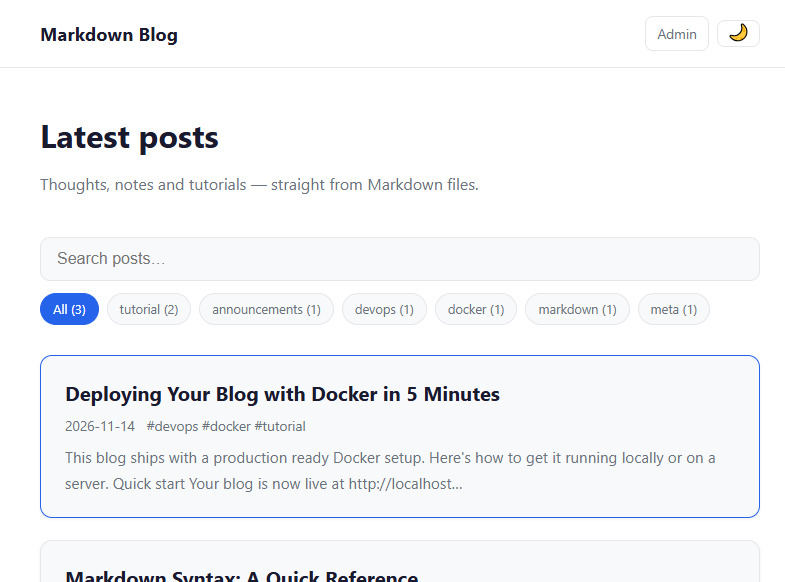
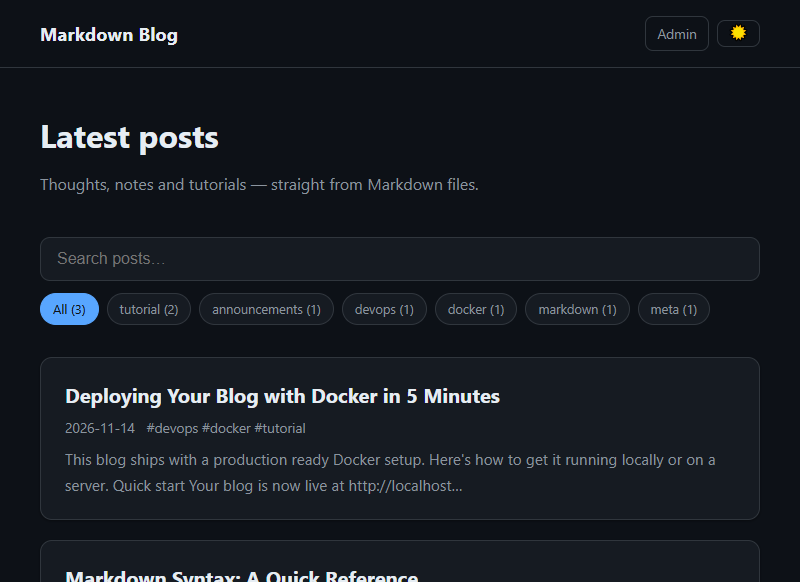

# Markdown Blog

A lightweight, open-source blog engine that runs entirely on **plain Markdown files**.
No database. No lock-in. Your posts are `.md` files you own, edit anywhere, and version with Git.


<!-- TODO: replace with the real template id once the app is registered with Hostinger -->
[](https://deploy.pages.hostinger.dev/template/markdown-blog)

## ✨ Features

### Reader
- **Clean, minimalist UI** — fast-loading, distraction-free reading experience
- **🌙 Dark / Light mode** — respects system preference, remembered per visitor
- **📱 Mobile responsive** — looks great on any screen size
- **🏷️ Tag filtering** — one-click filtering by category/tag
- **🔎 Instant search** — client-side search with zero network round-trips
- **💻 Syntax highlighting** — dozens of languages via highlight.js

### Admin dashboard (`/admin`)
- Secure login with credentials from environment variables
- **Create, edit, delete** posts right from the browser
- **Live preview** — rendered Markdown side-by-side as you type
- **Image uploads** — click to upload, the URL is inserted at your cursor
- Draft mode for work-in-progress posts

### SEO & feeds
- Dynamic per-post `<meta>` and **OpenGraph/Twitter** tags
- JSON-LD structured data (BlogPosting)
- Auto-generated **`sitemap.xml`**, **`rss.xml`**, and `robots.txt`

### Under the hood
- **File-based storage** — posts are Markdown files with YAML frontmatter in `/posts`
- **Zero database** — nothing to install, back up, or migrate
- **Dockerized** — optimized multi-stage image with persistent volumes

## 🚀 Quick start (Docker)

```bash
git clone https://github.com/your-org/markdown-blog.git
cd markdown-blog

# Configure environment
cp .env.example .env
# then edit .env — set ADMIN_USER, ADMIN_PASSWORD, AUTH_SECRET, SITE_URL
# generate a secret with:  openssl rand -hex 32

# Build and run
docker compose up -d --build
```

- Blog: `http://localhost:3000`
- Admin: `http://localhost:3000/admin`

## 🚀 Quick start (local development)

Requires Node.js 18.17+.

```bash
npm install
cp .env.example .env      # then edit .env
npm run dev               # http://localhost:3000
```

## ✍️ Writing posts

### Via the admin dashboard
Sign in at `/admin`, click **+ New post**, write in Markdown with live preview, and publish. Uploaded images are stored in `/uploads` and referenced automatically.

### Via files
Drop a Markdown file into the `posts/` folder:

```markdown
---
title: "My First Post"
date: "2026-11-10"
tags: ["hello", "markdown"]
draft: false
---

Hello, world! This is **Markdown**.
```

| Frontmatter key | Required | Description                                        |
| --------------- | -------- | -------------------------------------------------- |
| `title`         | yes      | Post title (defaults to the filename)              |
| `date`          | no       | `YYYY-MM-DD`; posts are sorted newest first        |
| `tags`          | no       | List or comma-separated string                     |
| `draft`         | no       | `true` hides the post from the public site         |
| `excerpt`       | no       | Custom excerpt; auto-generated if omitted          |

## 🐳 Deployment notes

### Persistent volumes
`docker-compose.yml` mounts two volumes so **user content survives updates**:

| Volume         | Container path | Contains                    |
| -------------- | -------------- | --------------------------- |
| `posts_data`   | `/app/posts`   | Your Markdown articles      |
| `uploads_data` | `/app/uploads` | Images uploaded via admin   |

Updating is safe:

```bash
git pull
docker compose up -d --build   # content lives on the volumes, not the image
```

### Environment variables

| Variable               | Description                                    | Default               |
| ---------------------- | ---------------------------------------------- | --------------------- |
| `SITE_URL`             | Public URL (SEO, sitemap, RSS)                 | `http://localhost:3000` |
| `NEXT_PUBLIC_SITE_NAME`| Site name shown in header/title                | `Markdown Blog`       |
| `ADMIN_USER`           | Admin dashboard username                       | `admin`               |
| `ADMIN_PASSWORD`       | Admin dashboard password (**required**)        | —                     |
| `AUTH_SECRET`          | Secret signing admin session cookies (**required**) | —               |
| `POSTS_DIR`            | Override posts storage path (advanced)         | `./posts`             |
| `UPLOADS_DIR`          | Override uploads storage path (advanced)       | `./uploads`           |

## 📁 Project structure

```
markdown-blog/
├── posts/                  # ← Your Markdown posts live here
├── uploads/                # ← Images uploaded via the admin panel
├── public/                 # Static assets
├── src/
│   ├── app/
│   │   ├── page.tsx        # Home: post list + search + tags
│   │   ├── post/[slug]/    # Reader view
│   │   ├── tag/[tag]/      # Tag archive
│   │   ├── admin/          # Admin dashboard
│   │   ├── api/            # Auth, post CRUD, preview, upload
│   │   ├── rss.xml/        # RSS feed
│   │   ├── sitemap.ts      # sitemap.xml
│   │   └── robots.ts       # robots.txt
│   ├── components/         # ThemeToggle, PostBrowser
│   └── lib/                # Content layer, markdown, auth
├── Dockerfile              # Multi-stage production image
├── docker-compose.yml      # With persistent volumes
└── .env.example
```

## 🛠️ Tech stack

- [Next.js 14](https://nextjs.org) (App Router) + TypeScript + React
- [marked](https://marked.js.org) for Markdown rendering
- [highlight.js](https://highlightjs.org) for code blocks
- [gray-matter](https://github.com/jonschlinkert/gray-matter) for frontmatter
- Zero database — the filesystem *is* the database

## 📸 Screenshots

| Home (light) | Home (dark) | Admin editor with live preview |
| ------------ | ----------- | ------------------------------ |
|  |  |  |

## 🤝 Contributing

Contributions are welcome! Please open an issue or pull request.

## 📄 License

[MIT](LICENSE)
